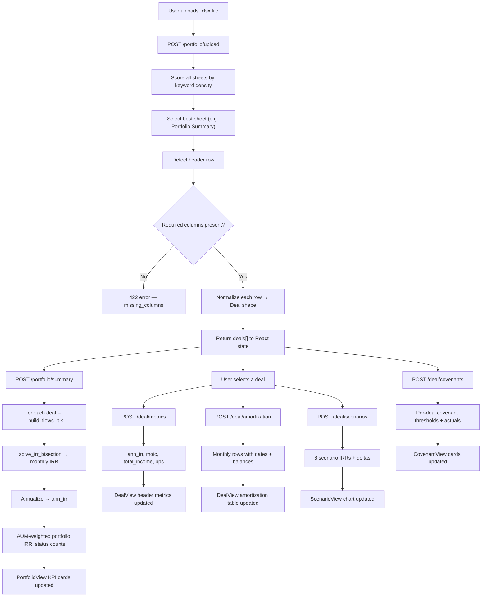

# Private Credit — Calculation Flow

This document explains step-by-step what happens after a user uploads an Excel portfolio file, from raw bytes to every number displayed in the UI.

---

## Architecture Overview

All financial calculations now run on the **backend** (FastAPI + Python). The browser no longer computes IRR or amortization — it only renders the results returned by the API.

```
Browser (React)
    │
    │  1. POST /portfolio/upload   (multipart file)
    │  2. POST /portfolio/summary  (deals[])
    │  3. POST /deal/metrics       (single deal)
    │  4. POST /deal/amortization  (single deal)
    │  5. POST /deal/scenarios     (single deal)
    │  6. POST /deal/covenants     (deals[])
    ▼
FastAPI Backend (api/)
    ├── api/main.py               — route definitions
    ├── api/schemas.py            — Pydantic request/response models
    └── api/services/
        ├── upload_service.py     — Excel/CSV/JSON parsing
        └── portfolio_service.py  — all financial calculations
```

---

## Step 1 — File Upload & Sheet Selection

**Endpoint:** `POST /portfolio/upload`  
**File:** `api/services/upload_service.py` → `parse_upload_full()`

```
Browser sends multipart/form-data with the .xlsx file
          ↓
Backend receives bytes (max 10 MB)
          ↓
openpyxl opens the workbook
          ↓
SHEET SELECTION — every sheet is scored:
  score += 1 for each keyword found in first 20 rows
  keywords: borrower, company, name, principal, instrument,
            amount, rate, tenure, status, loan, deal
  → Sheet with highest score is used
  (avoids picking "Payment Schedule" or "Covenant Tracker" by mistake)
          ↓
HEADER ROW DETECTION — scans first 20 rows:
  → First row containing ≥ 1 keyword = header row
          ↓
SCHEMA VALIDATION — checks for required columns:
  Interest Rate, Tenure (Mo.), Orig. Fee, EOT Fee,
  Borrower/Company name
  → If missing → 422 error with missing_columns list
          ↓
DATA ROWS — every row after header is collected
  → Skip blank rows
  → Skip totals (rows starting with TOTAL / SUBTOTAL / GRAND / PORTFOLIO)
```

**Returns:** `{ deals: Deal[], filename, row_count }`

---

## Step 2 — Row Normalization

**File:** `api/services/upload_service.py` → `_norm_row()`

Each raw Excel row is converted to a standard `Deal` shape using fuzzy column matching:

| Excel Column (examples) | Deal Field | Normalization |
|---|---|---|
| `Borrower`, `Company`, `Borrower Name` | `name` | String, default `"Deal N"` |
| `Instrument Type`, `Instrument`, `Type` | `instrument_type` | Lowercased |
| `Principal ($)`, `Loan Amount`, `Commitment` | `principal` | Float, strip `$`, `,` |
| `Interest Rate`, `Coupon`, `Rate` | `rate` | If value > 1 → divide by 100 (e.g. `12.25` → `0.1225`) |
| `Tenure (Mo.)`, `Term`, `Tenor` | `tenure` | Int, default 36 |
| `Orig. Fee`, `Origination Fee` | `orig_fee` | Same % → fraction logic |
| `EOT Fee`, `End of Term Fee`, `Exit Fee` | `eot_fee` | Same % → fraction logic |
| `PIK Rate`, `PIK` | `pik_rate` | Same % → fraction logic, default 0 |
| `Origination Date`, `Closing Date` | `origination` | Handles `datetime`, Excel serial, or string → ISO date string |
| `Maturity Date` | `maturity` | ISO date string |
| `Covenant Status`, `Status` | `status` | Lowercased → `compliant` / `monitoring` / `breach risk` |
| `Interest Type` | `interest_type` | String, e.g. `Fixed`, `Floating` |
| `IO Period`, `Interest Only` | `io` | Int months, default ~20% of tenure |

**IO default logic:**
```
if io not in file:
    io = round(tenure * 0.2)   # roughly 20% IO period
amort = tenure - io
```

---

## Step 3 — Portfolio Summary

**Endpoint:** `POST /portfolio/summary`  
**File:** `api/services/portfolio_service.py` → `analyze_portfolio()`

```
Input: deals[]
          ↓
AUM = Σ principal_i

Weighted Rate = Σ (rate_i × principal_i) / AUM

For each deal:
  → _compute_metrics(deal)      ← builds cash flows + solves IRR (see Steps 4–6)
  → collect ann_irr, moic, total_income, bps breakdown

Portfolio IRR = Σ (ann_irr_i × principal_i / AUM)   ← AUM-weighted

Status counts:
  compliant   = deals where status == "compliant"
  monitoring  = deals where "monitor" in status
  breach      = deals where "breach" in status
```

**Returns:**
```json
{
  "aum": 7400000,
  "deal_count": 5,
  "port_irr": 0.1745,
  "wtd_rate": 0.1311,
  "compliant": 2,
  "monitoring": 2,
  "breach": 1,
  "deal_irrs": [
    { "deal_id": "D001", "name": "NeuraLink Health", "irr": 0.1439, "moic": 1.235, ... }
  ]
}
```

---

## Step 4 — Cash Flow Construction

**File:** `api/services/portfolio_service.py` → `_build_flows_pik()`

This is the core of every IRR calculation. It builds a monthly array of net cash flows:

```
Variables:
  P         = principal
  rate      = annual cash coupon (decimal)
  pik_rate  = annual PIK rate (decimal)
  io        = interest-only months
  amort     = amortization months
  tenure    = io + amort (total months)
  orig_fee  = origination fee (decimal)
  eot_fee   = end-of-term fee (decimal)

─────────────────────────────────────────────────────────
Month 0 (lender's initial outflow, net of upfront fee):
  CF[0] = -P × (1 - orig_fee)
  ─ origination fee is treated as lender income received at close,
    reducing the net cash deployed

─────────────────────────────────────────────────────────
IO Phase  (months 1 → io):
  interest   = balance × (rate / 12)
  pik        = balance × (pik_rate / 12)     ← accrues to balance, not paid
  balance   += pik                            ← balance grows
  CF[m]      = interest                       ← only interest is received

─────────────────────────────────────────────────────────
Amortization Phase  (months io+1 → tenure-1):
  interest       = balance × (rate / 12)
  principal_pmt  = original_P / amort        ← level payment
  balance       -= principal_pmt
  CF[m]          = interest + principal_pmt

─────────────────────────────────────────────────────────
Final Month  (month tenure):
  interest       = balance × (rate / 12)
  principal_pmt  = remaining balance         ← repay all
  eot_fee_amt    = original_P × eot_fee      ← exit fee collected
  CF[tenure]     = interest + principal_pmt + eot_fee_amt
```

---

## Step 5 — IRR Bisection Solver

**File:** `api/services/portfolio_service.py` → `solve_irr_bisection()`

```
Given flows[], find monthly rate r such that NPV = 0:
  NPV(r) = Σ flows[t] / (1 + r)^t = 0

Method: bisection search
  r_low  = -0.999
  r_high = 10.0
  tolerance = 1e-10
  max iterations = 200

  Each iteration:
    r_mid = (r_low + r_high) / 2
    if NPV(r_mid) × NPV(r_low) < 0 → r_high = r_mid
    else → r_low = r_mid
    stop when |NPV| < tolerance

Annualized:
  ann_irr = (1 + r_monthly)^12 - 1
```

---

## Step 6 — Deal Metrics

**Endpoint:** `POST /deal/metrics`  
**File:** `api/services/portfolio_service.py` → `_compute_metrics()`

```
ann_irr      = annualized IRR (from bisection)
m_irr        = monthly IRR (raw bisection result)

total_interest = Σ (balance_m × rate / 12)   for all months

orig_fee_amt   = principal × orig_fee
eot_fee_amt    = principal × eot_fee

total_income   = total_interest + orig_fee_amt + eot_fee_amt

MOIC = (total_income + principal) / principal
     = (Σ all cash inflows) / principal

Basis-point breakdown (annualized contribution):
  coupon_bps = int(rate × 10000)
  orig_bps   = int((orig_fee / tenure × 12) × 10000)
  eot_bps    = int((eot_fee / tenure × 12) × 10000)
  pik_bps    = int(pik_rate × 10000)
```

**Returns:**
```json
{
  "ann_irr": 0.1439,
  "m_irr": 0.01128,
  "moic": 1.235,
  "total_income": 458250,
  "total_interest": 418250,
  "orig_fee_amt": 36000,
  "eot_fee_amt": 18000,
  "coupon_bps": 1225,
  "orig_bps": 67,
  "eot_bps": 33,
  "pik_bps": 0
}
```

---

## Step 7 — Amortization Schedule

**Endpoint:** `POST /deal/amortization`  
**File:** `api/services/portfolio_service.py` → `get_amortization()`

Generates one row per month with actual calendar dates:

```
origination_date = parsed from deal.origination (ISO string)
  fallback: today - tenure months

For each month m from 1 to tenure:
  date     = origination_date + m months
  phase    = "IO"            if m ≤ io
           = "Amort"         if io < m < tenure
           = "Amort (Final)" if m == tenure
  interest = open_balance × (rate / 12)
  pik      = open_balance × (pik_rate / 12)
  prin     = 0                         (IO phase)
           = original_P / amort        (Amort phase)
           = remaining balance         (Final month)
  eot      = original_P × eot_fee      (Final month only, else 0)
  total    = interest + prin + eot
  close_bal = open_bal - prin + pik
  status   = "paid"    if date < today
           = "pending" if date ≥ today
```

**Example row:**
```json
{
  "m": 1,
  "date": "2025-02-01",
  "phase": "IO",
  "open_bal": 1800000,
  "interest": 18375.0,
  "prin": 0.0,
  "eot": 0.0,
  "total": 18375.0,
  "close_bal": 1800000,
  "status": "paid"
}
```

---

## Step 8 — Scenario Analysis

**Endpoint:** `POST /deal/scenarios`  
**File:** `api/services/portfolio_service.py` → `analyze_scenarios()`

8 preset scenarios modify the base deal parameters and rerun the full IRR calculation:

| # | Label | Rate Δ | Tenure Δ | PIK Δ | Orig Δ | EOT Δ |
|---|---|---|---|---|---|---|
| 1 | Base case | 0 | 0 | 0 | 0 | 0 |
| 2 | Maturity +6mo | 0 | +6 | 0 | 0 | 0 |
| 3 | Rate +150bps | +1.5% | 0 | 0 | 0 | 0 |
| 4 | PIK +5% toggle | 0 | 0 | +5% | 0 | 0 |
| 5 | Rate -100bps | -1.0% | 0 | 0 | 0 | 0 |
| 6 | Maturity +12mo | 0 | +12 | 0 | 0 | +1% |
| 7 | Cov waiver +2% | +2.0% | 0 | 0 | +1.5% | 0 |
| 8 | Distressed restr. | -2.0% | +18 | +3% | 0 | +2% |

Each scenario:
```
new_rate    = max(0.04, base_rate + rate_delta)
new_tenure  = base_tenure + tenure_delta
new_io      = base_io  (or tenure-6 for distressed)
new_amort   = new_tenure - new_io
→ _build_flows_pik(new params)
→ solve_irr_bisection(flows)
→ ann_irr = (1 + monthly_irr)^12 - 1
delta = ann_irr - base_irr
```

---

## Step 9 — Covenant Analysis

**Endpoint:** `POST /deal/covenants`  
**File:** `api/services/portfolio_service.py` → `analyze_covenants()`

Covenants are assigned by instrument type:

| Instrument | Covenants Tracked |
|---|---|
| Term Loan / Senior Secured | Min. liquidity ratio, Min. revenue growth, Max. leverage (D/E), Min. DSCR |
| Convertible Note | Min. liquidity ratio, Min. revenue growth, Max. burn multiple |
| Revenue-Based Note | Min. revenue growth, Max. leverage, Min. DSCR |
| Bridge Loan | Min. liquidity ratio, Max. leverage |

For each covenant, threshold and actual values are generated deterministically from the `deal_id` seed and the deal's `status` field:

```
status = "compliant"   → actuals are comfortably inside thresholds
status = "monitoring"  → 1–2 covenants at 75–90% of threshold
status = "breach risk" → 1 covenant exceeds threshold
```

**Example output:**
```json
{
  "deal_id": "D001",
  "covenants": [
    {
      "name": "Min. liquidity ratio",
      "threshold": "1.5x",
      "actual": "2.34x",
      "pct": 100.0,
      "status": "compliant"
    }
  ]
}
```

---

## Step 10 — Custom IRR (IRR Modal)

**Endpoint:** `POST /irr/calculate`  
**File:** `api/services/portfolio_service.py` → `calculate_custom_irr()`

Used by the IRR calculator modal where the user manually inputs deal parameters:

```
Input:  principal, rate, io_months, amort_months, orig_fee, eot_fee, pik_rate
          ↓
tenure = io_months + amort_months
          ↓
→ _build_flows_pik()
→ solve_irr_bisection()
          ↓
Returns same DealMetricsResponse as /deal/metrics
```

---

## Caching

**File:** `api/services/portfolio_service.py`

Results are cached in-memory with a 5-minute TTL to avoid re-computing the same deal on repeated requests:

```python
cache_key = sha256(json.dumps(input_data, sort_keys=True))
cache[key] = { "result": ..., "ts": time.time() }
# Entries expire after 300 seconds
```

---

## Full Data Flow (Mermaid)



---

## Important Assumptions

- All rates and fees are stored as **decimals** internally. `12.25%` is stored as `0.1225`.
- Percent inputs > 1 in the uploaded file are automatically divided by 100.
- **Origination fee** is treated as lender income received at close — it reduces the net initial cash outflow (not added back as a positive flow).
- **EOT fee** is only collected in the final month of the deal.
- **PIK** increases the outstanding balance each month but is not a cash flow until the balance is repaid.
- The final amortization month repays the entire remaining balance (handles rounding drift).
- Portfolio IRR is weighted by **original principal**, not outstanding balance.
- Covenant actuals are deterministically seeded from `deal_id` — they are consistent across re-renders but are illustrative, not live data.
- Results are cached for 5 minutes. Cache is per-process (in-memory, not Redis).
