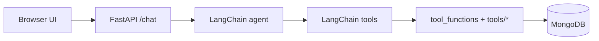

# Private Credit Analyst — Project overview

This repository is a **Python** private credit stack: **portfolio and deal** queries (MongoDB), **IRR and restructuring** math, and **document helpers**, all callable through **LangChain tools**. The **FastAPI** app (`api/main.py`) exposes **`POST /chat`**, which runs a **ChatAnthropic** agent with those tools.

## Stack

| Layer | Technology |
|-------|------------|
| **HTTP API** | **FastAPI** — `/chat`, `/upload`, `/health` |
| **Agent** | **LangChain** `create_agent` + **Anthropic** (`langchain-anthropic`) |
| **Tools** | **`private_credit_mcp/langchain_tools.py`** → **`tool_functions.py`** → **`tools/`** |
| **Data** | **MongoDB** via **`private_credit_mcp/data/db.py`** |
| **Seed** | **`private_credit_mcp/data/seed_deals.json`** — **`private-credit-seed`** CLI |

## Running locally

```bash
pip install -e ".[dev]"
python -m uvicorn api.main:app --reload --port 8000
```

Frontend (optional): `cd frontend && npm install && npm run dev` → **http://localhost:5173**.

## Flow



Tool implementations live in **`private_credit_mcp/tool_functions.py`** (portfolio, IRR, documents). **`langchain_tools.py`** wraps them as **`@tool`** callables; **`ALL_LANGCHAIN_TOOLS`** is what the agent receives.

## Related docs

- **Mongo:** `database/MONGODB_SETUP.md`
- **Prompts for manual QA:** `TOOL_SMOKE_PROMPTS.md`
