# Private Credit Nexus AI

A portfolio analytics workspace for venture debt and private credit. Upload a deal tape (Excel, CSV or JSON) and get IRR, MOIC, amortization schedules, restructure scenarios and covenant views per deal. An AI analyst runs on a LangGraph agent that calls the project's own Python finance tools. IRRs, schedules and scenario numbers are calculated in Python; the language model explains them and decides which tool to call. It does not supply the figures.


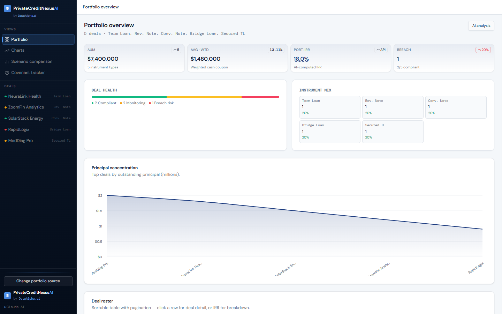

## Contents

- [Overview](#overview)
- [Features](#features)
- [Screenshots](#screenshots)
- [Graphs and what they show](#graphs-and-what-they-show)
- [How the AI analyst works](#how-the-ai-analyst-works)
- [Data sources and LLM fallback](#data-sources-and-llm-fallback)
- [Architecture](#architecture)
- [Tech stack](#tech-stack)
- [Project structure](#project-structure)
- [Installation](#installation)
- [Environment variables](#environment-variables)
- [Running the app](#running-the-app)
- [Example analysis workflow](#example-analysis-workflow)
- [API reference](#api-reference)
- [Testing and production build](#testing-and-production-build)
- [Deployment](#deployment)
- [Security considerations](#security-considerations)
- [Known limitations](#known-limitations)
- [Planned improvements](#planned-improvements)
- [Contributing](#contributing)
- [License](#license)

## Overview

Venture debt deals are not plain loans. A typical facility has an interest-only period, then amortization, an upfront origination fee, an end-of-term (EOT) fee, sometimes PIK interest, and sometimes warrants. The coupon alone understates the return. To answer "what does this deal actually earn, and what happens if we extend it six months?", an analyst usually rebuilds a cash-flow model in a spreadsheet.

This project does that modelling from a deal tape:

1. **Ingest.** The backend reads an uploaded workbook, finds the right sheet and header row, matches column names against a list of aliases, and normalizes each row into a deal record.
2. **Calculate.** Python builds monthly cash flows for each deal and solves for IRR by bisection. It also produces MOIC, income breakdown, a dated amortization schedule and eight restructure scenarios.
3. **Explain.** A chat panel sends questions to a LangGraph agent with 21 finance tools. The agent calls tools such as `calculate_term_loan_irr` and writes up the result. Every tool call is returned to the UI with its inputs, output and duration.

The repository ships five sample workbooks with fictional companies so the app can be tried without real deal data.

## Features

**Portfolio ingestion**
- Upload `.xlsx`, `.xlsm`, `.xls`, `.csv` or `.json` files up to 10 MB (`MAX_UPLOAD_MB`).
- Required columns: Borrower / Company, Instrument Type, Principal, Interest Rate, Tenure, Orig. Fee, EOT Fee, Covenant Status. Each one accepts several aliases, such as "Coupon" for rate or "Tenor" for tenure.
- Picks the sheet with the most portfolio keywords and finds the header row within the first 20 rows. Skips TOTAL, SUBTOTAL and NOTE rows. Reads IO and amortization months from text like `IO 12 mo -> 24 mo amortizing`, including from a separate `Deal Details` sheet.
- Missing columns are reported back to the UI by name.
- Five sample portfolios load in one click, and each can be downloaded as a template.
- Files can also be loaded from a URL. The browser fetches the file, then uploads it to the API.

**Deterministic analytics** (Python, with a browser fallback in `frontend/src/utils/irrMath.ts`)
- Per-deal annualized IRR, monthly IRR, MOIC, total income, and an IRR decomposition in basis points (coupon, origination, EOT, PIK).
- Portfolio IRR, calculated as the principal-weighted average of deal IRRs.
- Month-by-month amortization schedule with calendar dates and paid / current / pending markers.
- Eight preset restructure scenarios, plus a custom scenario with your own rate, tenure, IO, fees and PIK.
- An editable "Change scenario" mode on each deal that recalculates metrics and the schedule. Up to five scenarios can be kept as tabs for the current session.

**AI analyst**
- Free-text chat, plus ready-made prompts from the deal toolbar (IRR, Schedule, Restructure, IRR Impact, Covenants), from the scenario page and from the covenant page.
- An agent with 21 LangChain tools covering IRR for term loans, notes, warrants and convertibles; scenarios; DPO breakeven; term sheets; and restructure memos.
- Provider fallback across Anthropic, OpenAI, Gemini and Groq for `/chat`.
- A portfolio-level "AI analysis" summary that sends the deterministic metrics to Claude as ground truth.

## Screenshots

All screenshots come from a local run of this repository using **bundled sample data** (Sample 1, `nexus-fund-ii.xlsx`, fictional companies). None of it is live deal data. The AI answer in the last screenshot is a real response from Claude through `POST /chat`.

**Connect screen.** Upload a file, load from a URL or API endpoint, or try a sample portfolio. The required columns are listed above the samples.

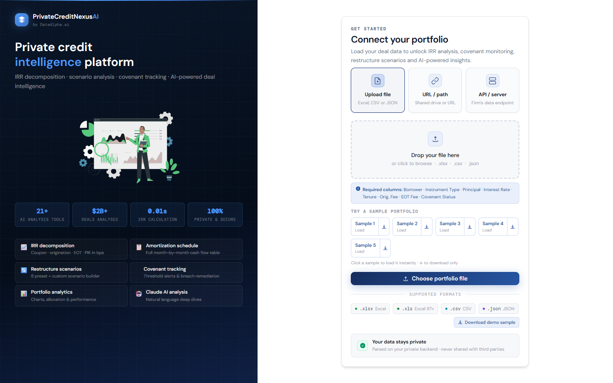

**Portfolio overview.** KPI cards, deal health, instrument mix, principal concentration and the deal roster. The sidebar lists every deal with its covenant-status colour.


**Portfolio charts.** IRR per deal, allocation by principal, monthly interest income, principal by instrument type, and covenant status distribution.

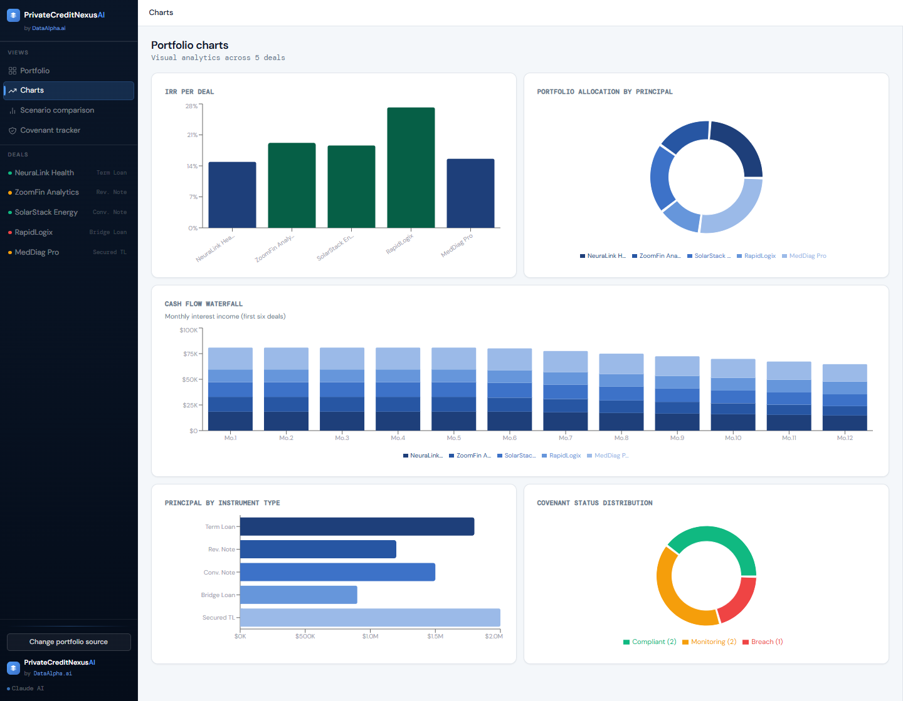

**Scenario comparison.** Eight restructure presets for the selected deal, a custom scenario builder, and a bar chart comparing every scenario's IRR against the base case.

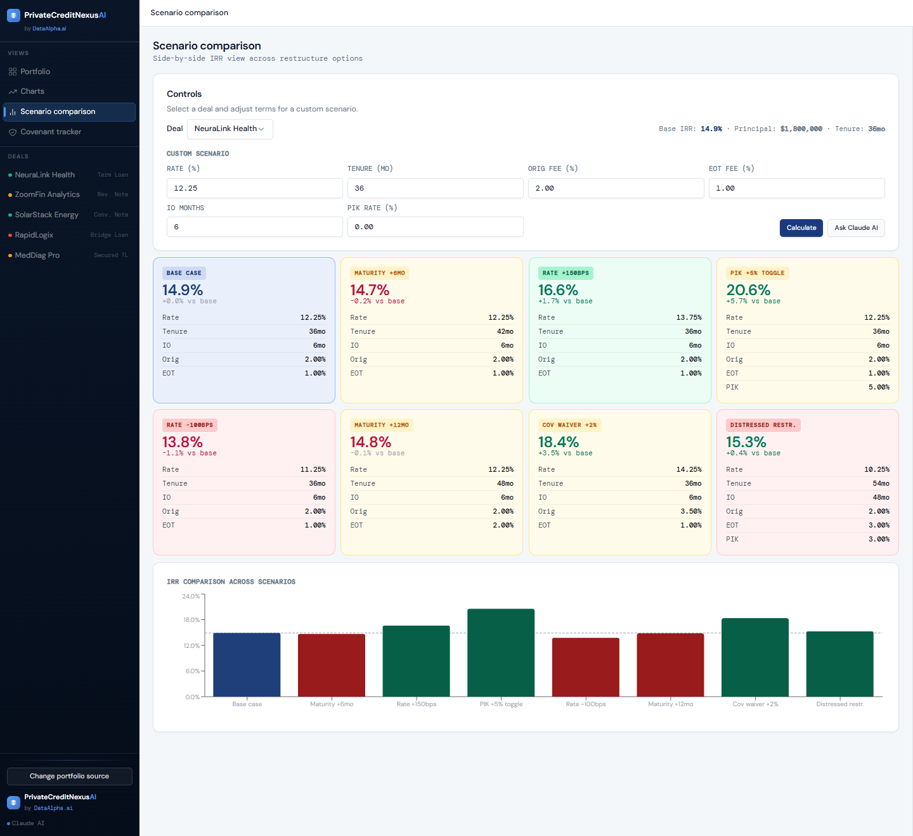

**Covenant tracker.** Status counts and per-deal covenant cards. The covenant measurements shown are illustrative; see [Known limitations](#known-limitations).

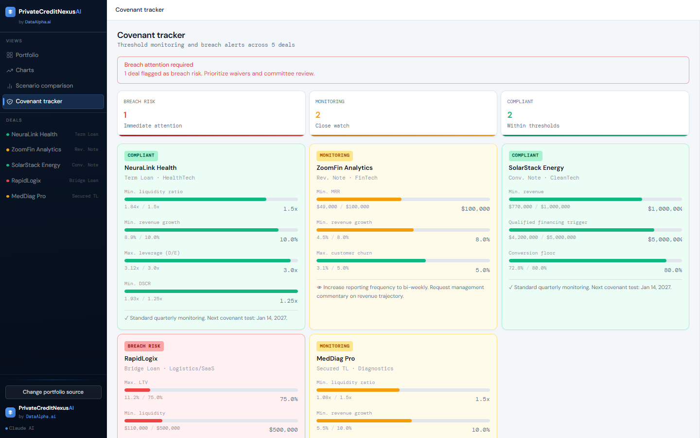

**Deal detail.** Deal parameters, IRR, MOIC and the dated monthly payment schedule. The **Run analysis** menu at the bottom sends deal-specific prompts to the AI analyst.

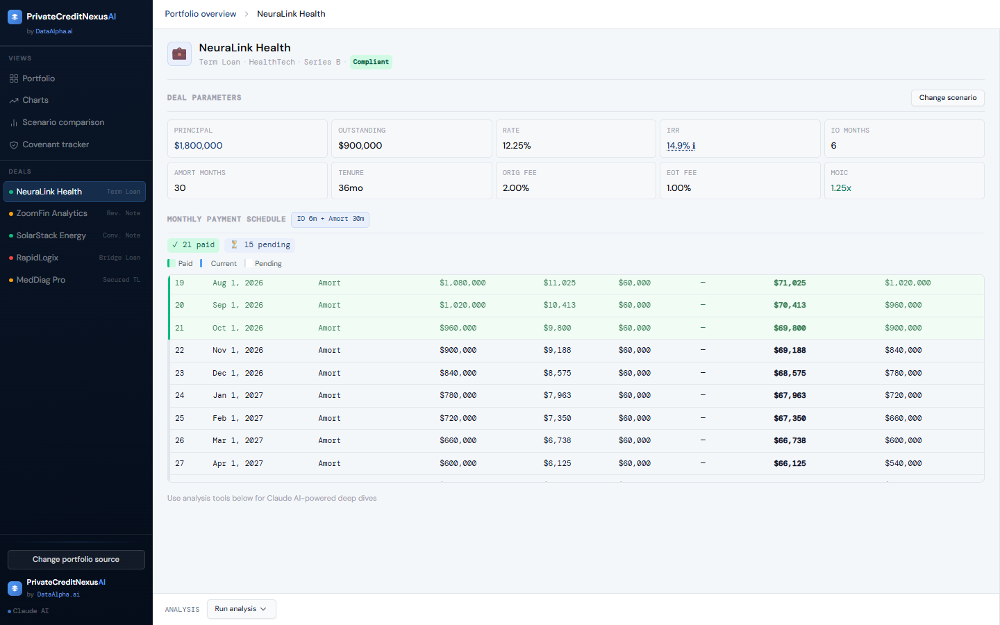

**Portfolio IRR breakdown.** Opened from the Port. IRR card. Shows per-deal IRRs and how the portfolio figure is calculated.

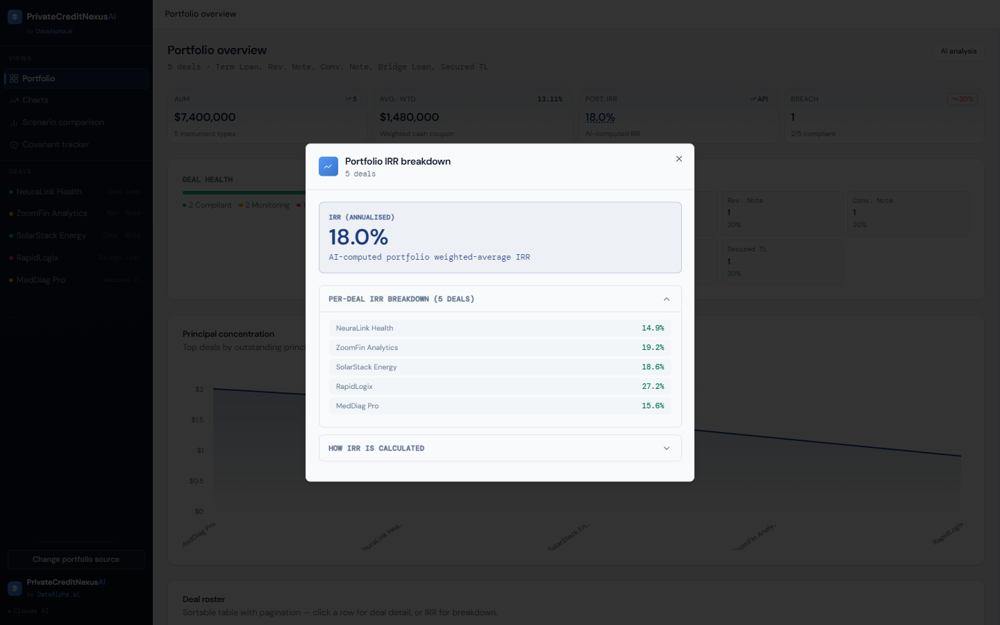

**AI analyst.** The IRR tool run for one deal. Claude called `calculate_term_loan_irr` (73 ms; the row is visible under the answer) and returned a Markdown summary with fee decomposition in basis points.

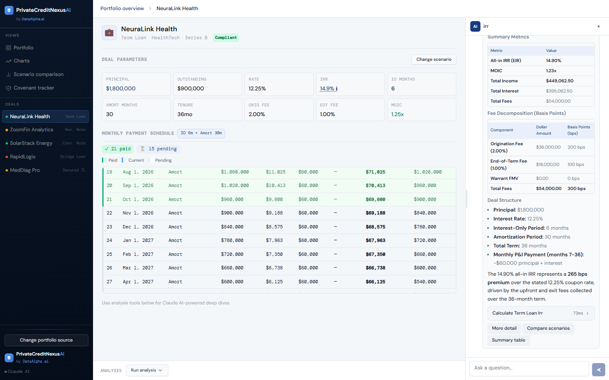

## Graphs and what they show

Every chart is drawn in the browser with Recharts from the deals currently loaded. None of them use market data or live feeds: the inputs are the uploaded file plus calculations from the backend or the browser. Where a value can come from either side, the backend result is used when it arrives, and the browser result is shown until then or if the API is unreachable.

### Portfolio overview

| Element | What it shows | How to read it |
| --- | --- | --- |
| **AUM card** | Sum of `principal` across deals, with the number of instrument types | Original commitment, not outstanding balance |
| **Avg · Wtd card** | Average deal size; badge shows the principal-weighted cash coupon | Weighted coupon is the rate before fees, so it sits below the IRR |
| **Port. IRR card** | Principal-weighted average of annualized deal IRRs from `POST /portfolio/summary` (badge "API"), or the browser calculation as a fallback | Click it to open the IRR breakdown. The card's subtitle says "AI-computed", but the number is deterministic Python output; no LLM is involved |
| **Breach card** | Count and share of deals whose Covenant Status is breach risk | Taken directly from the uploaded status column |
| **Deal health bar** | Stacked proportions of compliant (green), monitoring (amber) and breach-risk (red) deals | From the Covenant Status column only |
| **Instrument mix** | Deal count and percentage per instrument type | Concentration by structure, not by dollars |
| **Principal concentration** (area chart) | Top 12 deals sorted by principal, in $M. X axis: deal; Y axis: principal | A ranked concentration curve. A steep drop means a few deals dominate. The line between deals only connects ranks and has no meaning of its own. The card subtitle says "outstanding principal", but the chart plots `principal` |

### Charts page

| Chart | Axes and encoding | How to read it |
| --- | --- | --- |
| **IRR per deal** (bar) | X: deal. Y: annualized IRR %. Colour: dark green at 18% or more, navy from 14% to 18%, brown below 14% | Compares all-in returns, including fees and PIK, across deals. Values come from `/portfolio/summary`, falling back to the browser calculation |
| **Portfolio allocation by principal** (donut) | One slice per deal, sized by principal | Single-name concentration |
| **Cash flow waterfall** (stacked bar) | X: months 1–12 from each loan's start. Y: monthly interest income ($). One stack segment per deal, first six deals only | Expected interest income only. Interest is charged on the balance left after that month's scheduled principal, so bars shrink as loans amortize. It excludes principal repayments, fees and PIK, and months are loan-relative rather than calendar months. Despite its title, this is a stacked bar chart, not a true waterfall |
| **Principal by instrument type** (horizontal bar) | Y: instrument type. X: total principal ($) | Dollar exposure by structure. Pair it with the instrument mix card, which counts deals |
| **Covenant status distribution** (donut) | Compliant / monitoring / breach counts | Same data as the deal health bar, as a donut |

### Scenario comparison

Pick a deal and the page calls `POST /deal/scenarios`, which reprices the deal under eight presets:

| Preset | Change applied to the base deal |
| --- | --- |
| Base case | None |
| Maturity +6mo | Tenure +6 months |
| Rate +150bps | Rate +1.5% |
| PIK +5% toggle | PIK rate +5% |
| Rate -100bps | Rate -1% (floored at 4%) |
| Maturity +12mo | Tenure +12 months, EOT fee +1% |
| Cov waiver +2% | Rate +2%, origination fee +1.5% |
| Distressed restr. | Rate -2%, tenure +18 months, IO extended to tenure minus 6 months, EOT +2%, PIK +3% |

Each card shows the scenario IRR and its change from base. The **IRR comparison across scenarios** bar chart plots every scenario's IRR (Y axis, %) against the scenario name (X axis). The dashed line marks the base IRR. Bars are green above base, red below, and navy for the base case itself. A scenario above the line improves the lender's return. **Calculate** prices a custom scenario: the browser result appears straight away and is replaced by the backend's when it returns.

### Deal detail and IRR breakdown

- **Payment schedule** (`POST /deal/amortization`): one row per month with date, phase (IO or Amort), opening balance, interest, principal, EOT fee, total payment and closing balance. Rows dated before today are marked **paid**, but that only means the date has passed. No payment records exist in this app.
- **IRR breakdown modal**: annualized IRR, the IRR decomposition (coupon, origination, EOT and PIK in bps), an income breakdown, per-deal IRRs for the portfolio view, and a step-by-step explanation of the calculation.

### How IRR is calculated

`api/services/portfolio_service.py` builds monthly cash flows:

- **Month 0:** `-(principal - origination fee)`, because the fee is netted from the amount funded.
- **Months 1 to tenure:** interest on the running balance; zero principal during IO, then straight-line principal of `principal / amort_months`.
- **PIK:** accrues on the balance each month.
- **Final month:** repays the remaining balance plus final PIK and the EOT fee.

The monthly IRR is solved by bisection and annualized as `(1 + m)^12 - 1`. MOIC is `(origination fee + all inflows) / principal`. Fee inputs below 1 are read as fractions of principal; values of 1 or more are read as dollar amounts.

## How the AI analyst works

The app keeps two roles apart:

- **Data and calculations** come from the uploaded file and from deterministic Python functions in `private_credit_mcp/tools/` and `api/services/portfolio_service.py`. The same inputs always give the same IRR.
- **The language model** decides which tool to call, with which arguments, and writes the explanation. It does not check numbers against any outside source, and its prose can still contain mistakes. Treat tool outputs as the figures and the narrative as commentary.

### Chat flow (`POST /chat`)

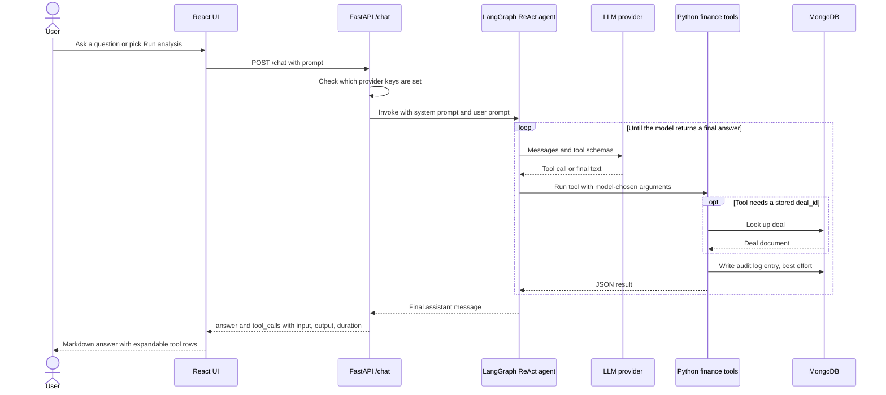

Step by step:

1. **Request.** The user types a question, or a button builds a prompt from the selected deal's terms. For example, Run analysis → IRR sends the deal's principal, rate, IO, amortization and fees, plus the dashboard's pre-computed IRR and MOIC.
2. **Validation.** FastAPI validates the body (`{"prompt": str}`). If no provider key is configured, it returns 503 straight away.
3. **Agent run.** A cached LangGraph `create_react_agent` graph runs with a system prompt that sets the analyst role and formatting rules, such as Markdown tables and `14.8%` style figures.
4. **Tool calls.** The model picks tools. Raw-parameter tools such as `calculate_term_loan_irr` and `calculate_note_irr` work on uploaded deals. Tools that take a `deal_id` read the MongoDB `deals` collection, so they only know seeded deals, not the uploaded file.
5. **Transparency.** A callback records every tool call: name, input, output and milliseconds. The UI shows these as collapsible rows under the answer, so the numbers behind the prose can be checked.
6. **Errors.** Provider failures move on to the next provider (next section). If every provider fails, the API returns one normalized error without raw provider messages. Each response carries an `x-request-id` header that matches the server logs.

### Agent tools

| Group | Tools | Needs MongoDB |
| --- | --- | --- |
| IRR from raw parameters | `calculate_irr`, `calculate_term_loan_irr`, `calculate_note_irr`, `calculate_warrant_irr`, `generate_warrant_irr`, `calculate_conv_note_irr` | No |
| Documents | `generate_term_sheet`, `create_irr_model` | No |
| Stored-deal analytics | `get_deal_metrics`, `get_deal_cash_flows`, `get_amort_schedule`, `run_restructure_scenario`, `compare_before_after_irr`, `compare_all_scenarios`, `get_outstanding_at_breach`, `calculate_dpo_breakeven`, `generate_restructure_memo` | Yes |
| Portfolio and market context | `get_portfolio_summary`, `get_covenant_alerts`, `search_precedent_deals`, `search_comparable_deals` | Yes |

Every tool also tries to write an audit row (MongoDB `audit_logs` plus `logs/audit.log`). If that write fails, the error is logged and the tool still returns its result.

### Portfolio AI summary (`POST /portfolio/ai-summary`)

The **AI analysis** button on the overview:

1. calculates portfolio metrics deterministically;
2. puts them, with one line per deal, into a prompt that tells Claude to treat them as the source of truth;
3. asks Claude to cross-check with tools and return Executive Summary, Key Metrics, Main Risks, Recommended Actions and MCP Tool Cross-Checks sections.

This endpoint uses Anthropic only (no fallback) and needs `ANTHROPIC_API_KEY`. The prompt also tells the model to call MongoDB-backed tools. If MongoDB is unreachable, the tool error currently ends the whole request with a 502 (verified locally), so a reachable database is effectively required for this feature.

## Data sources and LLM fallback

This project uses **no market-data, news or web-search providers**. Finnhub, Event Registry, NewsData.io and SerpAPI do not appear in the codebase. Its only data sources are:

| Source | Role | Required |
| --- | --- | --- |
| Uploaded file (Excel, CSV, JSON) | The active portfolio for every dashboard view | Yes, for the dashboard |
| Python calculators | IRR, MOIC, schedules, scenarios | Built in |
| MongoDB (`MONGODB_URI`) | Seeded `deals` for stored-deal agent tools; `audit_logs` | For stored-deal tools, the AI summary and audit rows |
| LLM providers | Reasoning, tool selection and narrative | For chat and AI summary |

### Provider order for `/chat`

Defined in `api/services/tool_execution.py` and `api/services/chat_service.py`:

| Order | Provider | Key | Model variable (default) |
| --- | --- | --- | --- |
| 1 | Anthropic | `ANTHROPIC_API_KEY` | `ANTHROPIC_MODEL` or `CLAUDE_MODEL` (`claude-sonnet-4-5-20250929`) |
| 2 | OpenAI | `OPENAI_API_KEY` | `OPENAI_MODEL` (`gpt-4o-mini`) |
| 3 | Google Gemini | `GEMINI_API_KEY`, `Gemin_API_Key` or `GOOGLE_API_KEY` | `GEMINI_MODEL` (`gemini-1.5-flash`) |
| 4 | Groq | `GROQ_API_KEY` | `GROQ_MODEL` (`llama-3.1-8b-instant`) |

All four providers play the same role: each runs the same agent with the same tools. None of them is a data source.

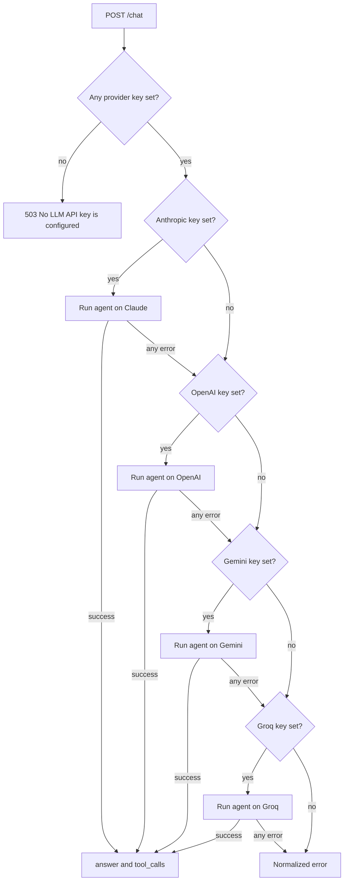

Failures are classified from the provider's error text: 401 authentication, 402 credits or quota, 400 model unavailable, 429 rate limit, 503 timeout or connection, otherwise 502. When every provider fails, the response uses the first of those statuses, in that order, that any provider returned. The tool-call list is shared across attempts, so a provider that failed partway through may leave tool rows in the final response.

## Architecture

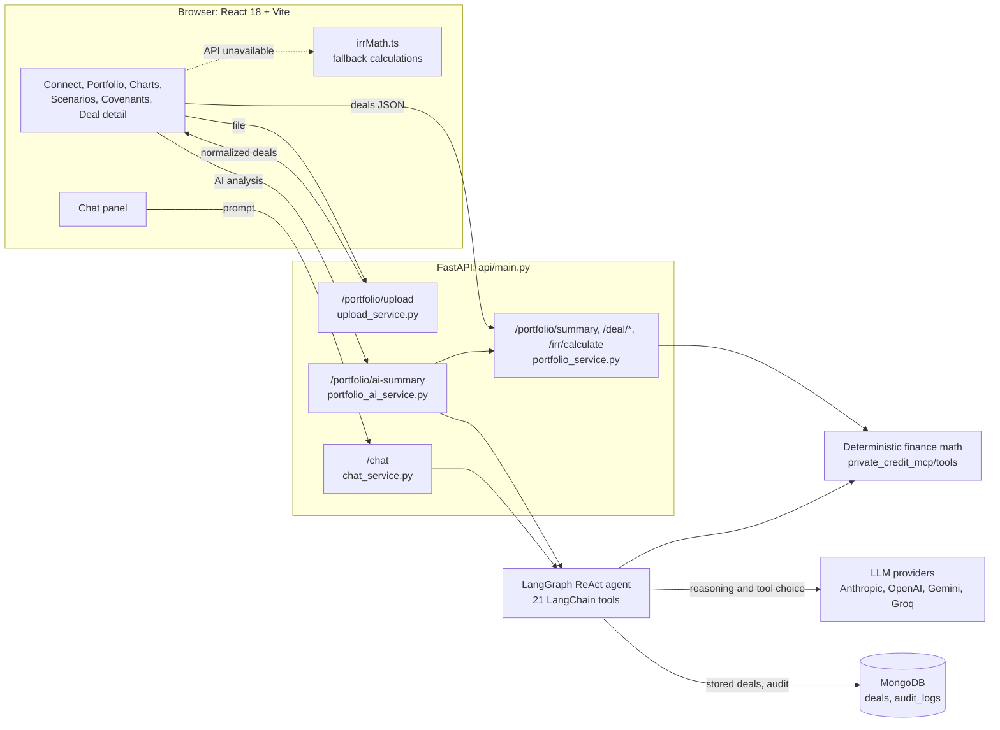

The API is stateless: uploaded files are parsed in memory and not stored, and the deals live in browser state. Every analytics call sends the deals it needs. In development, Vite proxies `/chat`, `/health`, `/upload`, `/portfolio`, `/deal` and `/irr` to `http://localhost:8000` when `VITE_API_URL` is empty.

## Tech stack

| Layer | Choice |
| --- | --- |
| UI | React 18, TypeScript 5, Vite 5, Tailwind CSS 3, shadcn/ui (Radix), Recharts 2, TanStack Table, react-markdown, sonner |
| API | FastAPI, Pydantic 2, uvicorn, python-multipart |
| Agent | LangGraph `create_react_agent`, LangChain tools, `langchain-anthropic`, `langchain-openai`, `langchain-google-genai`, `langchain-groq` |
| Files | openpyxl (Excel), csv, json |
| Database | MongoDB via pymongo |
| Tests | pytest, httpx (FastAPI `TestClient`) |
| Deploy config | Render Blueprint (`render.yaml`) for the API; SPA `_redirects` for a static frontend host |

## Project structure

```
api/
  main.py                    FastAPI app, routes, error envelope, request-id middleware
  schemas.py                 Pydantic request and response models
  services/
    upload_service.py        File parsing, column matching, row normalization
    portfolio_service.py     IRR, MOIC, schedules, scenarios, covenants (deterministic)
    chat_service.py          Provider fallback loop for /chat
    tool_execution.py        Model construction, agent graph, tool-call tracker
    portfolio_ai_service.py  Portfolio AI summary (Anthropic)
private_credit_mcp/
  tools/                     irr.py, portfolio.py, documents.py: finance and DB tools
  langchain_tools.py         21 @tool wrappers exposed to the agent
  data/db.py                 MongoDB access; data/seed_deals.json: 12 seed deals
  audit/logger.py            Audit log to file and MongoDB
  seed_mongo.py              private-credit-seed entry point
frontend/
  src/components/views/      PortfolioView, ChartsView, ScenarioView, CovenantView, DealView
  src/components/            ConnectScreen, ChatPanel, IrrModal, Sidebar, ui/
  src/utils/irrMath.ts       Browser fallback IRR math
  public/samples/            Five sample portfolios
tests/                       pytest suite (unit plus integration-marked tests)
scripts/                     test_sample_portfolios.py
database/                    Sample workbooks, MONGODB_SETUP.md
MD_File/                     Deeper design notes
docs/screenshots/            README images
render.yaml                  Render Blueprint for the API
```

## Installation

### Prerequisites

- **Python 3.11 or newer** (`requires-python = ">=3.11"`). Verified locally on 3.14.
- **Node.js 18 or newer** with npm. Verified with Node 24.
- **At least one LLM API key** for chat. Anthropic is required for the portfolio AI summary.
- **MongoDB** (Atlas or local) for stored-deal tools, the AI summary and audit rows. The dashboard works without it.

### Clone and install

```bash
git clone https://github.com/Sauravmehto/Private_Credit_Nexus_AI_AGENT.git
cd Private_Credit_Nexus_AI_AGENT

python -m venv .venv
# Windows
.venv\Scripts\activate
# macOS / Linux
source .venv/bin/activate

pip install -e ".[dev]"

cd frontend
npm install
cd ..
```

### Configure

```bash
# Windows
copy .env.example .env
copy frontend\.env.example frontend\.env
# macOS / Linux
cp .env.example .env
cp frontend/.env.example frontend/.env
```

Fill in `.env` (see the next section). Leave `VITE_API_URL` empty in `frontend/.env` for local development, so the UI uses the Vite proxy and your local API.

### Seed MongoDB (optional)

```bash
private-credit-seed
```

This upserts the 12 deals from `private_credit_mcp/data/seed_deals.json` into the `deals` collection of the database named in `MONGODB_URI`, and touches nothing else. See [database/MONGODB_SETUP.md](database/MONGODB_SETUP.md).

## Environment variables

### Backend (`.env` in the repo root)

| Variable | Required | Purpose |
| --- | --- | --- |
| `ANTHROPIC_API_KEY` | For the AI summary; one of four keys for chat | Claude, first in the fallback order |
| `ANTHROPIC_MODEL` / `CLAUDE_MODEL` | No | Claude model id. `ANTHROPIC_MODEL` wins if both are set. Default `claude-sonnet-4-5-20250929` |
| `OPENAI_API_KEY`, `OPENAI_MODEL` | No | Fallback 2 (default `gpt-4o-mini`) |
| `GEMINI_API_KEY` (or `Gemin_API_Key`, `GOOGLE_API_KEY`), `GEMINI_MODEL` | No | Fallback 3. The default `gemini-1.5-flash` has been retired by Google, so set a current model if you use Gemini |
| `GROQ_API_KEY`, `GROQ_MODEL` | No | Fallback 4 (default `llama-3.1-8b-instant`) |
| `MONGODB_URI` | For DB tools and the AI summary | The database name comes from the URI path, for example `.../private_credit?...` |
| `LOG_LEVEL` | No | Python log level, default `INFO` |
| `MAX_UPLOAD_MB` | No | Upload size limit, default `10` |

`.env.example` also lists `CORS_ALLOW_ORIGINS` and `Gemin_Client_ID`. The code reads neither; CORS is currently fixed to allow all origins (see [Security considerations](#security-considerations)).

### Frontend (`frontend/.env`)

| Variable | Purpose |
| --- | --- |
| `VITE_API_URL` | API origin. Empty means same origin through the Vite proxy (local dev). Set it to your deployed API URL when building for a static host |

Variables already set in the shell take precedence over `frontend/.env` in Vite.

### Where to get keys

| Provider | Console |
| --- | --- |
| Anthropic | https://console.anthropic.com/ |
| OpenAI | https://platform.openai.com/api-keys |
| Google Gemini | https://aistudio.google.com/apikey |
| Groq | https://console.groq.com/keys |
| MongoDB Atlas | https://www.mongodb.com/atlas |

Keep keys in `.env` only. `.env` and `.env.*` are gitignored, except the `.env.example` templates.

## Running the app

Two terminals from the repo root, with the virtualenv active:

```bash
# Terminal 1: API on port 8000
python -m uvicorn api.main:app --reload --port 8000
```

```bash
# Terminal 2: UI on port 5173
cd frontend
npm run dev
```

Open http://localhost:5173 and confirm the API is up:

```bash
curl http://localhost:8000/health
# {"status":"ok","service":"private-credit-chat-api","mongodb":"ok"}
```

`mongodb` is `ok`, `error` (with `mongodb_error`) or `skipped` when `MONGODB_URI` is unset. FastAPI's interactive docs are at http://localhost:8000/docs.

**If ports 8000 or 5173 are taken**, run both on other ports and point the UI at the API directly (CORS allows it):

```bash
python -m uvicorn api.main:app --host 127.0.0.1 --port 8765
# macOS / Linux / Git Bash
VITE_API_URL=http://127.0.0.1:8765 npx vite --port 5199 --strictPort
```

## Example analysis workflow

These figures come from a local run with Sample 1 (`nexus-fund-ii.xlsx`, fictional data):

1. **Load data.** On the connect screen, click **Sample 1 → Load**. The file is posted to `/portfolio/upload` and five deals are normalized.
2. **Portfolio view.** `/portfolio/summary` returns AUM $7.4M, portfolio IRR 18.0%, and 2 compliant, 2 monitoring and 1 breach-risk deal.
3. **Drill into a deal.** Pick *NeuraLink Health* in the sidebar: a $1.8M term loan at 12.25%, 6 months IO then 30 months amortizing, 2% origination fee, 1% EOT fee. The dashboard shows IRR 14.9% and MOIC 1.25x, plus a 36-row dated schedule.
4. **Stress it.** Open **Scenario comparison**. Rate +150bps lifts the IRR to 16.6%, Maturity +6mo lowers it to 14.7%, and a covenant waiver with fee reaches 18.4%.
5. **Ask the analyst.** From the deal page, choose **Run analysis → IRR**. Claude calls `calculate_term_loan_irr`, confirms an all-in IRR of 14.90%, and breaks out 200 bps of origination fee and 100 bps of EOT fee. The agent's tool reports MOIC as 1.23x against the dashboard's 1.25x, because the two code paths define MOIC differently.
6. **Follow up.** Type a question, or use the suggestion chips (More detail, Compare scenarios, Summary table).

Calling the API directly:

```bash
curl -F "file=@frontend/public/samples/nexus-fund-ii.xlsx" http://localhost:8000/portfolio/upload

curl -X POST http://localhost:8000/chat \
  -H "Content-Type: application/json" \
  -d '{"prompt":"IRR of a $1M term loan at 12%, 6 months IO, 30 months amortizing, 2% origination and 3% EOT fee"}'
```

## API reference

| Method and path | Body | Returns |
| --- | --- | --- |
| `GET /health` | None | Service status and MongoDB status |
| `POST /portfolio/upload` | multipart `file` | `{deals[], filename, row_count}` |
| `POST /upload` | multipart `file` | Columns, row count and a 5-row preview (validation only) |
| `POST /portfolio/summary` | `{deals[]}` | AUM, weighted rate, portfolio IRR, status counts, per-deal IRRs |
| `POST /portfolio/ai-summary` | `{deals[]}` | `{summary, metrics, tool_calls}` (Anthropic) |
| `POST /deal/metrics` | `{deal}` | IRR, monthly IRR, MOIC, income, bps decomposition |
| `POST /deal/amortization` | `{deal}` | Monthly schedule rows with dates and status |
| `POST /deal/scenarios` | `{deal, custom_params?}` | Eight presets plus an optional custom scenario |
| `POST /deal/covenants` | `{deals[]}` | Per-deal covenant list (illustrative, see limitations) |
| `POST /irr/calculate` | Explicit deal parameters | Same shape as `/deal/metrics` |
| `POST /chat` | `{prompt}` | `{answer, tool_calls[]}` |
| `GET /sample/venture_debt_portfolio.xlsx` | None | Sample workbook download |

HTTP and server errors use one envelope: `{"error": {"code", "message", "details", "request_id"}}`. Request-body validation failures (422) keep FastAPI's default `{"detail": [...]}` shape.

## Testing and production build

```bash
# Unit tests: no network, no database
python -m pytest -m "not integration"

# Full suite: also runs live tests that need a working ANTHROPIC_API_KEY and a reachable, seeded MongoDB
python -m pytest
```

The unit run passes 22 tests and deselects 2. They cover health, the error envelope, request-id propagation, every step of the provider fallback (with mocked providers), upload validation, IRR tools, schedules and scenarios. The integration tests skip themselves when their credentials are missing.

To check every sample portfolio against a running API on port 8000 (writes `database/SAMPLE_PORTFOLIO_TEST_RESULTS.md`):

```bash
python scripts/test_sample_portfolios.py
```

Frontend type-check and production build:

```bash
cd frontend
npm run build      # tsc, then vite build into frontend/dist
npm run preview    # serve the built bundle locally
```

## Deployment

- **API on Render.** `render.yaml` defines a Python web service. Build: `pip install -r requirements.txt && pip install .`. Start: `python -m uvicorn api.main:app --host 0.0.0.0 --port $PORT`. Health check: `/health`. Set the provider keys and `MONGODB_URI` in the Render dashboard; a local `.env` is not deployed.
- **Frontend on a static host.** Build with `VITE_API_URL` set to the API origin and deploy `frontend/dist`. `frontend/public/_redirects` (`/* /index.html 200`) handles SPA routing on Netlify-style hosts.

## Security considerations

- **No authentication.** Anyone who can reach the API can call every endpoint, including `/chat` and `/portfolio/ai-summary`, which spend your LLM credits. Put it behind a gateway, VPN or auth layer before exposing it publicly.
- **CORS allows all origins.** `api/main.py` sets `allow_origins=["*"]` and does not read `CORS_ALLOW_ORIGINS`.
- **Deal data reaches LLM providers.** AI features send deal names and terms in prompts to whichever provider answers. Uploaded files themselves are parsed in memory and not saved.
- **Secrets.** Keep keys in `.env` (gitignored). Rotate any key that has been pasted into chats, tickets or commits.
- **Audit trail.** Tool calls are logged to `logs/audit.log` and MongoDB `audit_logs`. There are no user identities, so `user_id` is always `anonymous`.
- **Uploads.** Limited by `MAX_UPLOAD_MB`; openpyxl opens workbooks with `data_only=True`, which reads cached cell values and does not evaluate formulas.

## Known limitations

- **Covenant measurements are illustrative.** Only the Covenant Status column comes from your file. The covenant names and thresholds are fixed per instrument type. The "actual" values and progress bars are generated from that status plus the deal name: a hash of the name in the backend (`analyze_covenants`), its first letter in the browser fallback. They are not real financial covenants, can contradict the status label (the screenshot shows a "compliant" deal with leverage 3.12x against a 3.0x maximum), and can change after an API restart because Python's string hashing is randomized per process.
- **Missing inputs are filled with defaults.** A blank rate becomes 12%, origination and EOT fees become 2% and 2.5%, a blank tenure becomes 36 months, and a missing origination date is estimated. A rate entered as `1` (meaning 1%) is read as 100%, and `05/03/2025` is read as 3 May rather than 5 March. Check normalized deals before relying on them.
- **Portfolio IRR is principal-weighted**, not a pooled IRR of combined cash flows.
- **"AI-computed" labels.** The Port. IRR card and IRR modal say "AI-computed", but those numbers are deterministic Python output.
- **Stored-deal agent tools do not see uploaded deals.** They query MongoDB seed data. The AI summary currently fails with 502 if MongoDB is unreachable.
- **No market, news or web data.** Comparables come only from the MongoDB seed deals.
- **Single-turn chat.** Each `/chat` request is independent; earlier messages are not sent back to the model.
- **The Gemini default model is retired.** Set `GEMINI_MODEL` if Gemini is part of your fallback chain.
- **Static marketing figures.** The connect screen shows fixed text such as "$2B+ deals analysed". These are not measurements produced by the app.
- `frontend/dist/` and `logs/audit.log` are committed even though `.gitignore` lists them.

## Planned improvements

None of the following is implemented yet:

- Authentication and per-user audit identities.
- Read `CORS_ALLOW_ORIGINS` from the environment.
- Replace synthetic covenant actuals with covenant data columns from the uploaded file.
- Flag missing or ambiguous inputs during upload instead of filling in defaults.
- Catch MongoDB tool errors so the AI summary can finish without a database.
- Provider fallback for the AI summary, multi-turn chat memory, and streaming responses.
- Move from `create_react_agent` (deprecated in LangGraph 1.0) to `langchain.agents.create_agent`.
- A pooled portfolio IRR alongside the weighted average.

## Contributing

1. Branch from `main`.
2. Keep business logic in Python services and tools. The browser math is only a fallback and should stay consistent with the backend.
3. Before opening a PR, run `python -m pytest -m "not integration"` and `npm run build` in `frontend/`.
4. Never commit `.env` files, keys or real deal data. Add sample data only with fictional names.

Further design notes: [MD_File/PRIVATE_CREDIT_MCP_EXPLAINED.md](MD_File/PRIVATE_CREDIT_MCP_EXPLAINED.md), [MD_File/CALCULATION_FLOW.md](MD_File/CALCULATION_FLOW.md), [MD_File/SAMPLE_PORTFOLIO_LOAD_FLOW.md](MD_File/SAMPLE_PORTFOLIO_LOAD_FLOW.md), [MD_File/TOOL_SMOKE_PROMPTS.md](MD_File/TOOL_SMOKE_PROMPTS.md).

## License

No license file is included yet, so default copyright applies and reuse requires the owner's permission. Add a `LICENSE` file before publishing if you want others to use the code.
